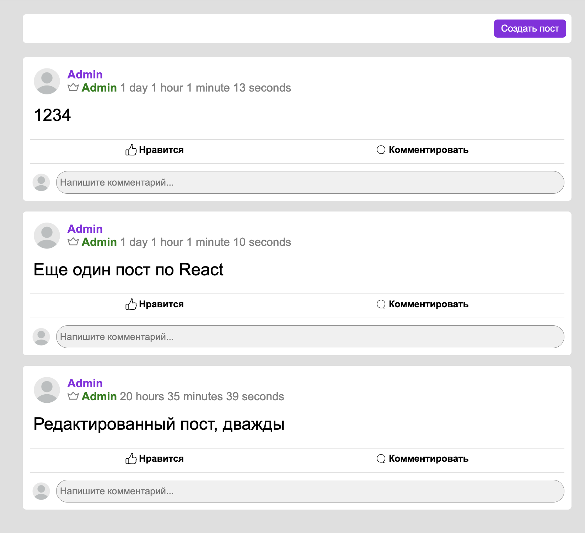
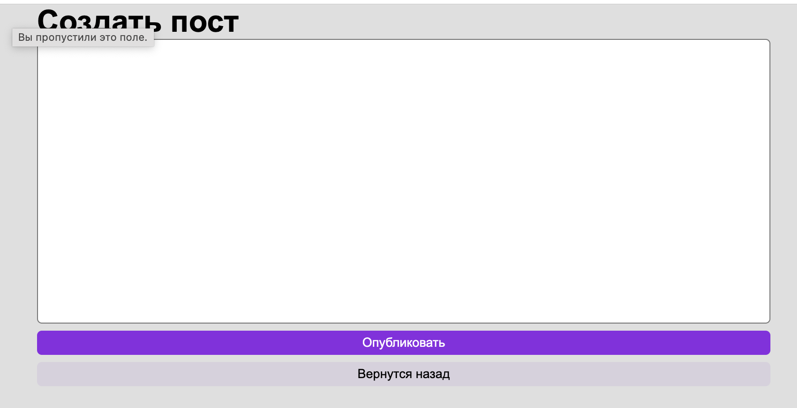
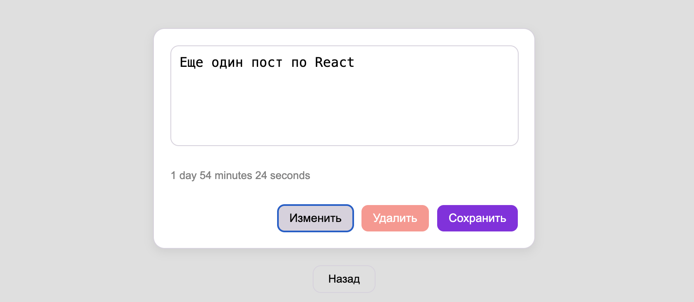
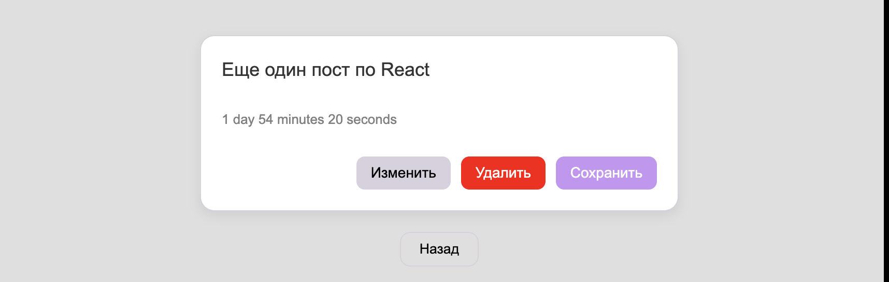

# Задание 10.2 Роутинг с CRUD методами

## Описание 

Реализация роутинга для 3х страниц 
- Список постов 
- Создание поста
- Манипуляции с постом(удаление, редактирование)

Реализация CRUD операций для работы с постами(GET)

## Зависимости 

- `react`
- `react-dom`
- `react-router-dom`
- `axios` - для более удобной работы с запросами
- `enhanced-ms` - для форматировании даты

## Пример интерфейса 

Пример главной страницы


Пример создания поста


Пример редактирования поста




## Код программы и структура проекта

Программа находится в папке `src`.
Backend находится в папке `CRUD-backend`.
`assets` в папке хранит в себе примеры интерфейса.

Структура проекта 
```
AdvancedJS_T10_RoutingWithCRUD/
├── public/ 
├── node_modules/
├── assents/ // скрины интерфейса
├── CRUD-backend/ // backend для программы
├── src/
│   ├── assets/
│   │   ├── icons/ // иконки
│   │   └── pics/ // картинки
│   ├── components/
│   │   ├── Post/ // компонент поста
│   │   │   ├── Post.tsx // компонент поста
│   │   │   └── Post.module.css // стили компонента
│   │   └── index.ts // для экспорта компонентов
│   ├── model/
│   │   └──  Post.ts // модель поста
│   ├── pages/
│   │   ├── CreatePost 
│   │   │   ├── CreatePost.module.css // стили
│   │   │   └── CreatePost.tsx // страница создания поста
│   │   ├── HomePage/
│   │   │   ├── HomePage.module.css // стили
│   │   │   └── HomePage.tsx // страница списка постов
│   │   ├── PostPage/
│   │   │   ├── PostPage.module.css // стили
│   │   │   └── PostPage.tsx // страница редактирования поста
│   │   └── index.ts // для экспорта страниц
│   ├── service/
│   │   └── postAPI.ts // сервис постов
│   ├── utils/
│   │   └── convertTime.ts // форматирование даты
│   ├── App.jsx // компонент приложения
│   ├── App.css // общий стиль для всего приложения
│   |── index.css // корневые стили для проекта 
│   └── main.jsx // главный компонент приложения
├── index.html
├── .gitignore 
├── package.json
└── vite.config.js
```

## Запуск программы

- Сборка программы: `npm run build`
- Установка зависимостей: `npm install`
- Запуск программы: `npm run dev`
- Привью программы: `npm run preview`

